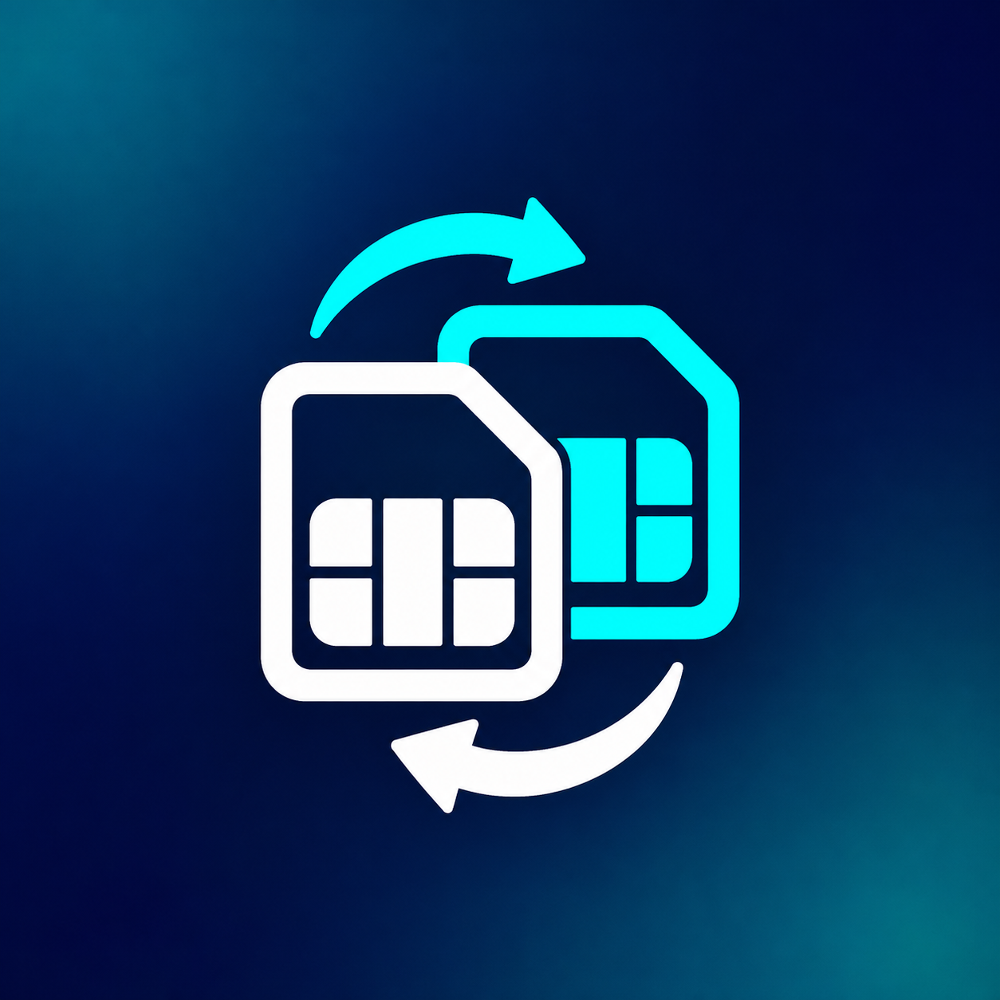
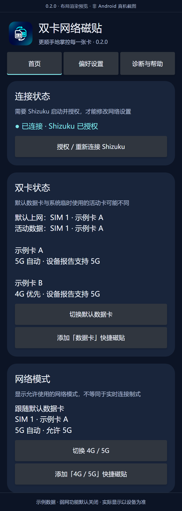
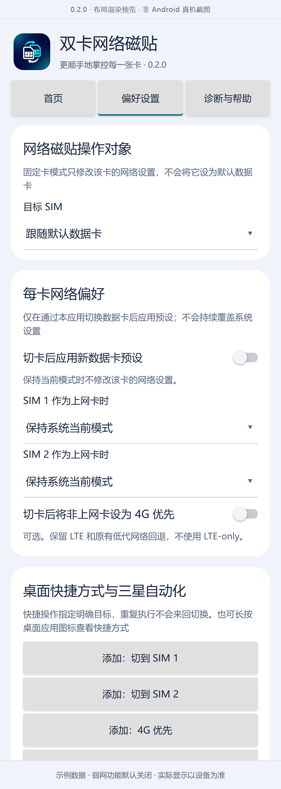
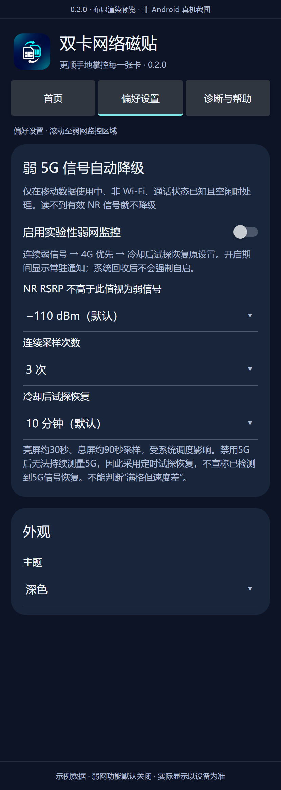
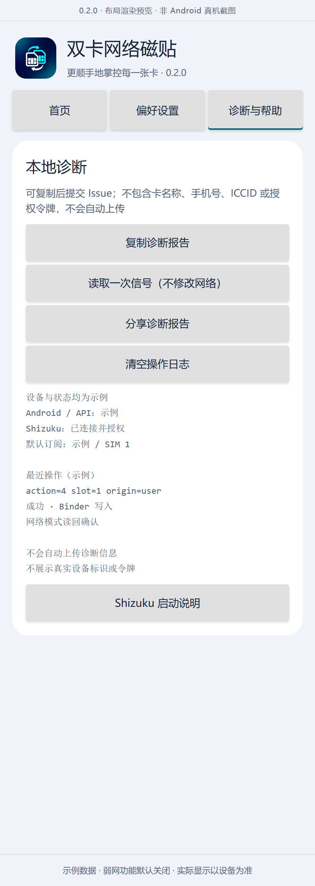

# 双卡网络磁贴 · Android 双卡切换与 4G/5G 快捷开关

**Dual SIM Network Tiles — Shizuku-powered mobile data SIM switcher and 4G/5G Quick Settings tiles.**



通过 **Shizuku**，在 Android 下拉快捷设置面板（Quick Settings）中添加两个开关：一键切换双卡手机的默认上网 SIM 卡，以及切换当前数据卡的 4G / 5G 网络模式。适合希望快速切换流量卡、管理手机 5G 开关的用户。

> **兼容性说明：目前仅在三星 Galaxy S24 Ultra、One UI 8.5 系统上测试通过。其他三星型号、其他 One UI 版本及其他品牌手机均未验证，不保证兼容。**

> 上述实测对应 **0.1.4 基线版**。**0.2.0 功能扩展测试版**新增诊断、接口探测、每卡偏好、原始设置恢复、快捷方式/自动化以及新版界面；弱 5G 信号自动降级为默认关闭的实验功能。新增功能尚待真机验证，详见 [0.2.0 使用与验收说明](docs/V0.2.0.md)。

## 界面预览 · 0.2.0

以下为根据当前布局代码制作的 **HTML/CSS 渲染预览**，不是 Android 模拟器或三星真机截图。卡名称、连接状态及诊断内容均为示例，原生控件、字体及实际显示以设备为准；不代表新功能已通过真机验证。点击图片可查看大图。

<table>
  <tr><th>首页 · 深色</th><th>每卡偏好 · 浅色</th><th>弱信号监控 · 深色</th><th>诊断 · 浅色</th></tr>
  <tr>
    <td><a href="docs/images/ui-home-dark.png"></a></td>
    <td><a href="docs/images/ui-preferences-light.png"></a></td>
    <td><a href="docs/images/ui-weak-signal-dark.png"></a></td>
    <td><a href="docs/images/ui-diagnostics-light.png"></a></td>
  </tr>
</table>

## English overview

Dual SIM Network Tiles is an Android utility that adds two **Quick Settings tiles**: a **mobile data SIM switcher** for changing the default data subscription, and a **4G/5G network mode toggle** for the selected data SIM. It requires **Shizuku**; a non-root setup is available through wireless debugging.

The SIM tile shows SIM 1 or SIM 2, and the network tile shows 4G or 5G according to the configured mode. Enabling 5G allows NR connectivity; it does not guarantee an active 5G connection. Disabling 5G retains the existing LTE and legacy fallback types rather than forcing LTE-only.

**Tested only on Samsung Galaxy S24 Ultra running One UI 8.5. Other devices, Samsung models and Android/One UI versions are untested.** Download the APK from [Releases](https://github.com/EnormousKnob/dual-sim-network-tiles/releases) and grant Shizuku access before adding the tiles.

The verified baseline is **0.1.4**. The **0.2.0 test build** adds diagnostics, per-SIM preferences, original-setting restoration, explicit shortcuts, token-protected automation and an optional signal-only fallback service. These additions have not yet been device-tested. Weak-signal monitoring is disabled by default and does not perform Internet speed tests.

## 功能：双卡数据切换与 4G/5G 网络模式

- **切换数据卡**：点击磁贴，在两张已启用的普通 SIM 卡之间切换默认上网卡；图标显示 **SIM 1 / SIM 2**，副标题显示卡名称。
- **切换 4G / 5G**：默认操作当前数据卡；0.2.0 可固定操作 SIM 1/2。图标随设置显示 **4G / 5G**，模式分别为“4G 优先”和“5G 自动”。
- **状态同步**：切换后读取系统设置确认，并同步更新两个磁贴；应用内也能查看默认数据卡、活动数据卡和网络模式。
- **本地运行**：无广告、无账号、无分析 SDK，不请求互联网权限，不上传 SIM 或网络信息。

**磁贴颜色说明：**数据卡磁贴的 SIM 1 为灰底，SIM 2 为亮底，仅用于区分选中的卡，灰底不代表关闭移动数据。这一显示方式解决了测试机上换卡后数字图标未即时刷新的问题。

**网络模式说明：**“5G 自动”表示允许使用 5G，不代表已经连接 5G；“4G 优先”表示禁用 5G，并保留原有 LTE 和低代网络回退，不强制 LTE-only。实际连接取决于信号、运营商、套餐及系统策略。

## APK 下载与 Shizuku 安装设置

从 [Releases](https://github.com/EnormousKnob/dual-sim-network-tiles/releases) 下载 APK，按需要选择版本：

- **[0.2.0 功能扩展测试版](https://github.com/EnormousKnob/dual-sim-network-tiles/releases/tag/v0.2.0)**：新增六项改进和默认关闭的弱信号实验监控；新功能尚未真机验证。
- **[0.1.4 已验证基线版](https://github.com/EnormousKnob/dual-sim-network-tiles/releases/tag/v0.1.4)**：双卡切换、4G/5G 切换和图标即时刷新已在三星 S24 Ultra / One UI 8.5 上确认可用。

发布的 APK 均为调试签名测试包，尚未在 Google Play 发布。0.2.0 与 0.1.4 使用相同签名，可覆盖升级；Android 通常不允许直接覆盖降级，回退前请先恢复所需系统设置并留意卸载会清除本地备份。

1. 安装并启动官方 [Shizuku](https://shizuku.rikka.app/zh-hans/guide/setup/)，非 Root 手机可通过无线调试启动。
2. 安装 APK，打开“双卡网络磁贴”，授予 Shizuku 权限。
3. 分别点击添加“数据卡”和“4G / 5G”磁贴，在系统对话框中确认。也可在下拉快捷面板的编辑页面手动添加。
4. 展开面板查看状态，点击磁贴切换。长按磁贴可返回应用；锁屏操作需要先解锁。

重启手机后，通常需要重新启动 Shizuku。应用需要两张已启用的普通 SIM 才能切换默认数据卡。

## 常见问题

### 三星 One UI 如何在下拉快捷面板切换上网卡？

启动 Shizuku 并授权本应用后，添加“数据卡”快捷磁贴。点击即可在两张已启用的普通 SIM 卡之间切换默认移动数据卡，无需每次进入 SIM 卡管理器。此流程目前仅在三星 S24 Ultra / One UI 8.5 上验证通过。

### 4G/5G 快捷开关能关闭 5G 吗？

可以。点击网络磁贴可在“5G 自动”和“4G 优先”之间切换：前者允许使用 5G，后者禁用 5G 并保留原有 4G 及低代网络回退。它不是移动数据总开关，也不是 LTE-only 锁网工具。

### 不 Root 可以切换双卡和网络模式吗？

本项目支持通过无线调试启动 Shizuku 的非 Root 授权方式。普通安装权限本身不足以修改相关电话设置，必须先启动 Shizuku 并授权；设备、固件和运营商策略仍可能限制操作。

## 测试范围

| 项目 | 结果 |
|---|---|
| 三星 Galaxy S24 Ultra / One UI 8.5 | 用户实测通过 |
| 默认数据卡切换 | 已确认可用 |
| 4G / 5G 模式切换及图标更新 | 已确认可用 |
| 换卡磁贴即时刷新 | 0.1.4 已确认可用 |
| 其他手机和系统 | 未验证 |

以上为功能实测记录，不代表所有网络环境、通话状态、SIM/eSIM 组合、运营商和企业管理策略都经过测试。详见 [真机测试记录](docs/DEVICE_TEST.md)。

## 从源码构建

环境：**JDK 17、Android SDK 36、Build Tools 35.0.0、Gradle 8.9**。项目最低 API 31（Android 12），targetSdk 36；最低 API 配置不代表其他设备已通过测试。

用 Android Studio 打开项目并配置 SDK，或在本地 `local.properties` 中设置 `sdk.dir`。首次构建需要访问 Google Maven 和 Maven Central。

```powershell
# Windows 中文路径推荐：在临时英文路径构建，输出到 artifacts/
.\build.ps1

# 可指定本机已安装的 Gradle
.\build.ps1 -GradleExecutable 'C:\path\to\gradle.bat'

# 英文路径下可直接使用 Gradle Wrapper
.\gradlew.bat assembleDebug testDebugUnitTest lintDebug
```

`build.ps1 -Release` 额外生成未配置生产签名的 release AAB；正式发布前需自行配置签名。请勿将密钥或本机配置提交到仓库。

当前 AGP 为 8.7.3，对 compileSdk 36 使用兼容警告抑制配置。生产发布前应升级到正式支持 API 36 的工具链并重新验证。

## 实现与限制

- 使用 Shizuku UserService，以用户授权的 shell/root 身份调用设备自身的电话服务；不硬编码 Binder 事务号。
- 三参数网络模式写入接口不存在时，使用固定参数的系统 `cmd phone` 兼容路径，切换后仍读回状态确认。
- 电话服务使用非 SDK 接口，固件升级或厂商差异可能导致功能失效。权限或系统策略拒绝操作时会报告错误。
- 系统自动数据切换可能临时使用另一张卡，活动数据卡不一定等于默认数据卡。网络磁贴始终操作默认数据卡。
- 系统配置读回成功不等于无线链路已经恢复，请以系统设置和实际联网情况为准。

## 致谢

本项目使用 [Shizuku API](https://github.com/RikkaApps/Shizuku-API)。应用图标采用项目中选定的双卡切换设计，快捷磁贴使用原生单色矢量图标。

## 支持作者

如果这款小工具让你的日常切卡、切换网络更顺手，欢迎通过下方二维码请作者喝杯咖啡，为后续维护和改进添一份动力。

资助完全自愿，不影响应用的正常使用。愿意尝试、反馈问题或分享给有需要的人，同样是对这个项目的支持。感谢你的心意。

<table>
  <tr><th>微信支付</th><th>支付宝</th></tr>
  <tr>
    <td align="center"><a href="docs/support/wechat.jpg"></a></td>
    <td align="center"><a href="docs/support/alipay.jpg"></a></td>
  </tr>
</table>

点击图片可查看原图。
